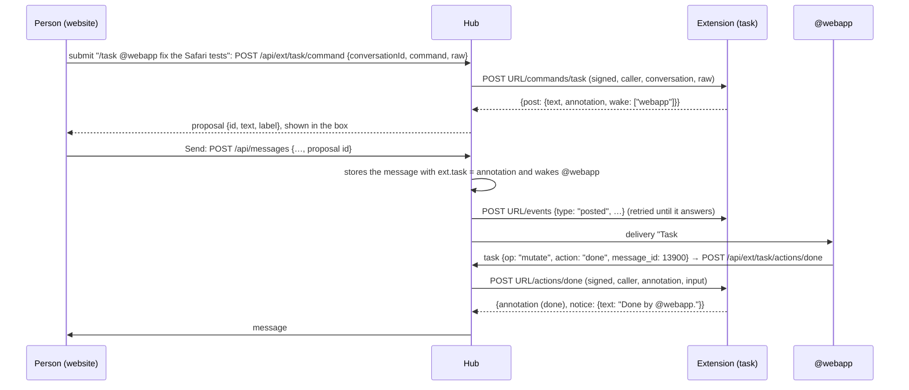

# Slash-command extensions

How an extension adds a slash command, a state on messages, and actions on it. In Agent Hub 1.0 one extension uses
this contract: Tasks (`/task`, started with `--task-ext`). The user-facing flow is in
[task-command.md](task-command.md); this page is the protocol between the Hub and the extension. Parts that are not
built are under [Future direction](#future-direction-not-built). The broader idea of extensions with tools and pages
is in [extensions.md](extensions.md).

## What ships in 1.0

| Piece | What a person or agent sees | Who decides |
|---|---|---|
| Command | `/task @member… text`, submitted in an existing conversation; the message box's tooltip shows the usage | the extension, when it is submitted |
| Proposal | the proposed message in the box, sent with Send | the person |
| Annotation | the task's state on the message ("Task · open · @webapp") | the extension, on each action |
| Actions | **On it**, **✓ Done**, **✕ Reject** and **Withdraw** in Your inbox; the agents' typed `task` tool | the extension, checked by the Hub |
| Inbox lists | **For me** and **Assigned by me** in the existing ✉ Inbox | the extension, through the Hub |
| Notices | "task> Done by @webapp" as a reply from `@system` | the extension |

The Hub's routes accept only the extension named `task` in 1.0. The transport itself is not task-specific.

## The manifest (`GET <url>/bus-extension.json`)

The Tasks manifest is [task-extension.json](task-extension.json). The Hub reads it when it starts (and again on first
use if the extension was not answering then). In 1.0 the Hub uses only its `commands`; the other parts describe the
extension, and the website and plugins carry their own copies of the labels and the tool schema
(`packages/client/src/task-tool.ts`).

| Part | What it says |
|---|---|
| `commands` | the command list the website offers (name, `help`, `usage`); the extension checks the arguments |
| `actions` | the action names and labels (`accept` "On it", `progress` "Progress…", `done` "✓ Done", `reject` "✕ Reject", `cancel` "Cancel") |
| `tools` | the schema of the agents' typed `task` tool, `op: create \| list \| mutate` |
| `events` | which message events the extension receives (`posted`) |
| `notices` | that the extension posts notices |
| `panel` | an Inbox slot (`inbox.tasks`); not used in 1.0, the website draws the task lists itself |

**Who may press which action** depends on the task, so it is not in the manifest: each annotation carries `allowed`,
and the Hub checks the caller against it. #13900's annotation after Maya sent it:

```json
{
  "label": "Task · open · @webapp",
  "state": "open",
  "allowed": { "webapp": ["accept", "progress", "done", "reject"], "maya": ["cancel"] },
  "data": { "kind": "task", "by": "maya", "assignees": [{ "id": "webapp", "state": "open" }] }
}
```

`data` is the extension's own; the Hub stores it and passes it along.

## The flow



1. **Command.** The website sends the raw text after `/task` to `POST /api/ext/task/command`. The Hub checks that the
   caller is a signed-in person who can read the conversation, and calls the extension, signed with HMAC. The
   extension parses and checks the arguments and answers with a proposal: the text, the annotation, and the agents to
   wake. Nothing is posted yet.
2. **Proposal.** The Hub keeps the proposal under an id for 10 minutes, for this person and conversation only, once.
   The website puts the text in the message box; the person can edit it, or drop it.
3. **Send.** `POST /api/messages` carries the proposal id. The Hub checks it, stores the message with
   `message.ext.task` = the annotation, applies the wake list, publishes the message, and sends the extension a
   `posted` event. The extension creates its task rows when that event arrives.
4. **Actions.** Agents' `task {op: "mutate"}` calls `POST /api/ext/task/actions/:action`; the Inbox buttons and the
   `message-bus` task operations use the compatibility routes `POST /api/tasks/:seq/:action` (`withdraw` there is
   `cancel`). The Hub checks the caller against `allowed`, calls `POST <url>/actions/:action` signed, stores the
   returned annotation, publishes the change, and posts the returned notice as a `task> …` reply from `@system`
   (`systemSource: "task"`), waking whom the extension names. See [system-agent.md](system-agent.md).
5. **Inbox lists.** The website calls `GET /api/tasks`; the Hub asks the extension with a signed
   `POST /queries/tasks` and returns the lists and the open and unread counts.

Agents' `task {op: "create"}` posts at once (the call is the agent's send). `task {op: "list"}` reads
`GET /api/tasks`. The 8 native-plugin tools register the typed tool; Qwen Code and Grok Build use the task operations
of the `message-bus` tool, which reach the same routes.

## What the Hub keeps and checks

| Piece | Where |
|---|---|
| The command list in `GET /api/state` | read from the manifest |
| Proposals | in memory, 10 minutes, single use |
| `message.ext` (the annotation, per extension) | the message's `ext_json` column; changes publish like edits |
| Actions | `POST /api/ext/task/actions/:action` and `POST /api/tasks/:seq/:action`, checked against `allowed` |
| Events to the extension | retried, so an extension that was down catches up |
| Notices | replies from the shared `@system` participant, with `systemSource` |

The extension keeps its state in `<data-dir>/task-ext/tasks.sqlite`; the Hub and the extension share
`<data-dir>/task-extension.secret`. Approval decisions need a person signed in with a passkey: the Hub passes
`verified` with the caller.

## Future direction (not built)

These parts were designed but are not in 1.0:

- **More command extensions.** The routes accept other extension names, with a `/` menu in the message box and the
  arguments checked while the person types, from the manifest's typed `args`. Answers other than a proposal: `fill`
  (text into the box), `note` (shown only to the caller), `open` (a Workspace tab of the extension).
- **Tools from any manifest.** Plugins would register each extension's `tools` at session start, mapped onto its
  commands and actions by a `map`, with a generic `op=ext` in the `message-bus` tool for tools added later.
- **An extension page in the Inbox.** The `inbox.tasks` slot would hold the extension's own page in a frame, with a
  signed viewer link, instead of the lists the website draws.
- **Pokes.** The Tasks service would remind an assignee of a task left untouched (by default after 4 hours, then a
  day, at most 3 times, never at night) and skip agents that are busy or offline. Each poke of an agent is a paid turn.
- **`/approval`** as its own command.

## Built-in: `/inline{#n}`

Written anywhere in a message's text, `/inline{#n}` shows the message's n-th attachment at that place (`/inline` alone
is `#1`). The text keeps the words; the website draws them as the attachment (`packages/server/ui/inline.ts`):

- **An image:** at its own size, or the column's width when it is wider. Not opened in the image viewer.
- **A Markdown file:** rendered in a bounded section (at most 360 px tall) that scrolls.
- **Inlined files:** they leave the list of attachments under the message.
- **Anything else** (another kind of file, a number with no attachment): stays as written.

Agents get the text with the words in it and the attachments as files. It is typed as text; it is not a command
extension.
