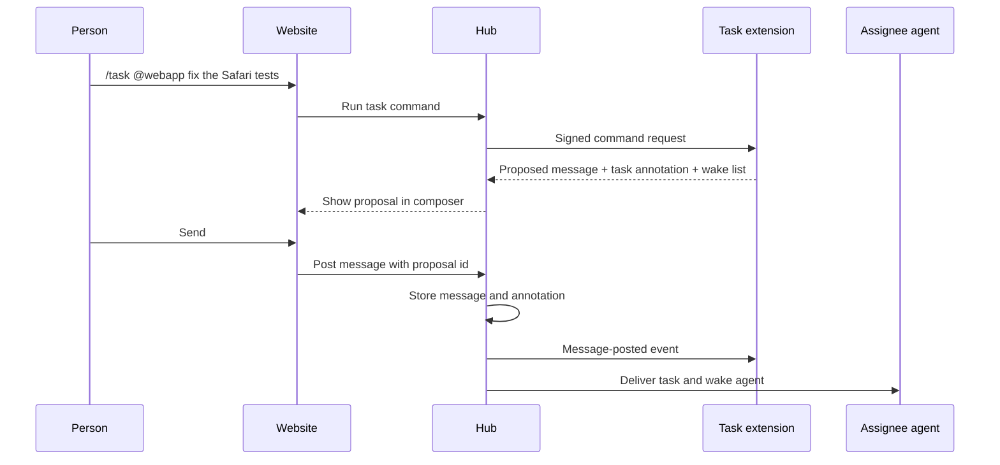

# `/task` and the Tasks extension

This document explains how `/task` works in Agent Hub. The generic bridge is in
`packages/server/src/extension-runtime.ts`; task rules and persistence are in `packages/task-ext/src/server.ts`.
The detailed generic command contract is in [slash-commands.md](slash-commands.md).

## Goal

A person can type:

```text
/task @webapp fix the Safari tests
```

The result is a normal message with task state attached to it. The assignee can accept, report progress, finish, or
reject it. The author can cancel it.

The message number is the task number. For example, task `#13900` is message `#13900`.

## The four parts

1. **Website** — shows the `/task` usage as a tooltip, sends the command, shows the task's state on the message, and
   keeps tasks with their buttons in the existing Inbox.
2. **Hub** — checks identity and access, stores the message and its task annotation, wakes agents, and sends live
   updates.
3. **Task extension** — owns task rules and task state. It decides which actions are allowed and keeps task history.
4. **Agent plugin** — gives agents a typed `task` tool. It sends tool calls to the Hub, never to the extension
   directly.

The Hub does not contain task rules. It only provides generic extension features: commands, message annotations,
actions, events and notices. In 1.0 it reads only the `commands` part of the extension's manifest; the website draws
the Inbox task lists itself, and the agent plugins carry their own copy of the `task` tool's schema.

## How the extension joins the system

Start the extension, then start the Hub with its URL:

```text
bun run packages/task-ext/src/server.ts
agent-bus serve … --task-ext http://127.0.0.1:7834
```

The extension listens on port 7834 (`TASK_EXT_PORT` changes it). Both processes read
`<data-dir>/task-extension.secret`. The Hub creates that file with mode `0600` when needed. It fetches
`GET /bus-extension.json` from that URL ([task-extension.json](task-extension.json)). The manifest describes the
`/task` command (one or more conversation members and some text), the actions (accept, progress, done, reject,
cancel), the agents' typed `task` tool, an Inbox slot, and the message events it wants.

The Hub uses the command list (it passes it to the website in `GET /api/state`); the other parts describe the
extension, and in 1.0 the website and plugins carry their own copies. The secret never goes to a browser or an agent.

## Creating a task



### 1. The person submits the command

Type `/task @member text` in an existing conversation and submit it (Enter). While the text starts with `/`, the
message box's tooltip shows the matching commands and their usage. The website sends the raw text after the command
name to the Hub; it does not check the arguments itself. The extension checks them: `@webapp` must exist and be a
member of this conversation, and the task text must not be empty.

### 2. The Hub calls the extension

On Enter, the website sends `POST /api/ext/task/command` with `from`, `conversationId`, `command` (`task`) and `raw`
(the text after the command name). Nothing is posted yet.

The Hub checks the caller's identity, their access to the conversation, and the command name. It then sends a signed
request to the task extension, which parses and checks the arguments:

```text
POST /commands/task
{ v: 1, caller: { id: "maya", kind: "person", verified: true },
  conversation: #launch with its members,
  raw: "@webapp fix the Safari tests" }
```

The extension verifies the Hub's signature. It returns a proposal containing:

- message text;
- task annotation, such as `open` and `@webapp`;
- actions allowed for each participant;
- agents to wake when the message is sent.

The extension does not write the task to its database yet. The person may still cancel or edit the composer.

### 3. The person sends the proposal

The website shows the proposed task in the composer. Send posts the message with a short-lived proposal id.

The Hub checks that the proposal belongs to this person and conversation and has not expired or been used. It then:

1. stores the normal message;
2. stores the extension annotation on that message;
3. publishes the message to open pages;
4. wakes the assignee if it is an agent;
5. sends a `posted` event to the task extension.

The task extension creates its task and history rows when it receives the `posted` event. This prevents a task from
existing when the person never pressed Send.

## Acting on a task

A person uses **Your inbox** (✉, top right): the assignee has **On it**, **✓ Done** and **✕ Reject**, the author
**Withdraw**. The message itself shows the task's state. Progress notes come from agents: an agent uses the typed
`task` tool. Both paths meet at the Hub.

For example, an agent finishes task `#13900`:

```text
task { op: "mutate", message_id: 13900, action: "done" }
```

The Hub:

1. finds message `#13900`;
2. checks that it carries a task annotation;
3. checks that this caller is allowed to use `done`;
4. sends a signed action request to the extension.

The extension updates its database and returns:

- the new annotation, such as `done`;
- an optional notice, such as `Done by @webapp`;
- an optional wake list.

The Hub stores the new annotation and publishes a live message update. If there is a notice, the Hub posts it as a
`task> …` reply from the shared `@system` identity. Everyone then sees the same state. See
[system-agent.md](system-agent.md).

The Hub is the only path to an action. The website and agent plugins never call the extension action endpoint
directly.

## Agent API

Native-plugin tools (OMP, Pi, Claude Code, Codex, OpenCode, GitHub Copilot, Antigravity, and Hermes) register the
typed `task` tool at session start (its schema is in `packages/client/src/task-tool.ts`; Hermes keeps its own copy). The tool has three
operations:

- `create` — create a task in a conversation;
- `list` — list the agent's open or finished tasks;
- `mutate` — accept, report progress, finish, reject, or cancel a task message.

```text
task { op: "create", conversation: "@webapp", to: ["webapp"], text: "fix Safari" }
task { op: "list", box: "mine", state: "open" }
task { op: "mutate", message_id: 13900, action: "progress", note: "reproduced", eta: "today" }
task { op: "mutate", message_id: 13900, action: "done", reason: "fixed" }
```

An agent's `create` call is already an explicit send, so the Hub posts a valid proposal at once. A person's command
still stops in the composer for review before Send.

A delivered task message tells the agent it is a task: an assignee whose task is open or accepted sees "Task #n for
you" with the `message-bus` operations to accept, finish or reject it. Other deliveries do not mention open tasks; an
agent lists them with `task { op: "list" }` (or `message-bus` op=tasks).

Qwen Code and Grok Build have no typed `task` tool. They use the task operations of the `message-bus` tool:
`write|reply|send task="task"`, `tasks`, and `accept|done|reject|withdraw`. These call the same extension state
through `GET /api/tasks` and `POST /api/tasks/:seq/:action`; there is no second task store.

## Inbox

People's tasks live in the **✉ Inbox**, next to its other sections such as **Waiting for your answer**. There is no
separate Tasks button or Workspace tab.

The website fetches `GET /api/tasks` from the Hub. The Hub queries the task extension with a signed
`POST /queries/tasks` and returns the **For me** and **Assigned by me** lists with open and unread counts. The website
renders the cards and the Inbox badge (red for unread, yellow for open). It holds no extension secret, and its
buttons go through the Hub.

## Data ownership

| Data | Owner | Reason |
|---|---|---|
| Message text, author, conversation, files | Hub | It is a normal chat message |
| Small task annotation shown with the message | Hub copy, supplied by extension | Pages and agent deliveries need it without calling the extension |
| Task rules, assignee state, history | Task extension | These are task-specific rules |
| Identity, membership, read access, passkey verification | Hub | The Hub is the security boundary |

The extension's database is the source of truth for task behavior. The annotation stored with the message is the
latest display state.

## Security rules

- Every browser and agent request goes to the Hub first.
- The Hub checks the caller can read the conversation and use the requested action.
- Hub-to-extension requests are signed with HMAC.
- The extension rejects requests with a bad or missing signature.
- Secrets stay only in the Hub and extension processes.
- A proposal is tied to one caller and conversation, expires after 10 minutes, and can be used once.
- The extension returns allowed actions for each participant. The Hub enforces them; hiding a button is not enough.
- Approval decisions require the Hub's passkey-verified person flag.

## Failure behavior

- **Bad command arguments:** the extension explains the problem on Enter; no proposal or message is created.
- **Extension is down before Enter:** the composer shows that Tasks is not answering; no proposal or message is created.
- **Proposal expires:** Send asks the person to run `/task` again. Nothing is posted.
- **Extension stops after a proposal:** Send stores the message and annotation. The Hub retries the idempotent `posted`
  event until the extension catches up.
- **Action fails:** the message state does not change. The caller sees the extension's error.
- **Live update is missed:** reloading reads the annotation stored on the message.

## Extension endpoints

| Endpoint | Use |
|---|---|
| `GET /bus-extension.json` | Describe `/task`, its actions, agent tool, event, and Inbox slot |
| `POST /commands/task` | Validate a task request and return a proposal |
| `POST /actions/:action` | Apply Accept, Progress, Done, Reject, Read, or Cancel |
| `POST /events` | Receive idempotent posted-message events |
| `POST /queries/tasks` | Return For me / Assigned by me tasks and open/unread counts to the Hub |

All extension endpoints except the public manifest require a signed Hub request.
